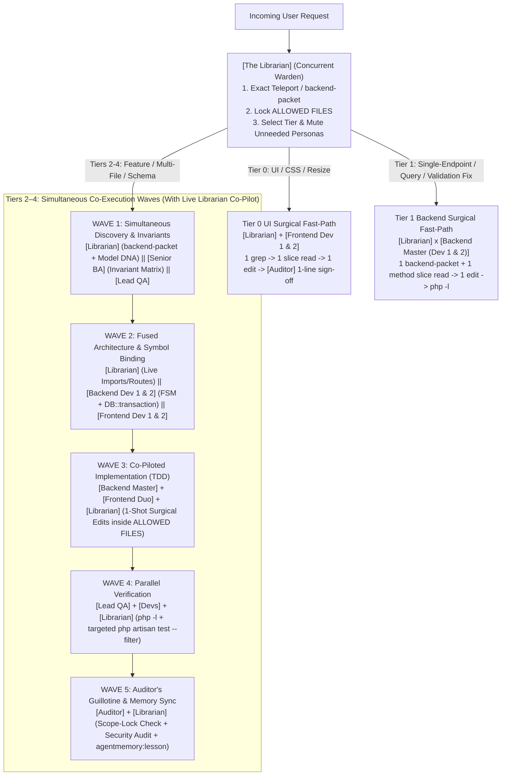

# [Workflow] — The Simultaneous Co-Execution & Conflict Matrix

**Mantra**: *"Personas never wait in a single-file waterfall. `[The Librarian]` streams live coordinates and Eloquent DNA simultaneously while the Backend Master and Frontend Duo build inside a locked Blast-Radius File Jail."*

---

## 1. Simultaneous Co-Execution Architecture

The Adversarial Engineering Collective (AEC) eliminates sequential waterfall bottlenecks by running **`[The Librarian]` as a continuous, concurrent co-processor** alongside the active personas across every wave, and by routing requests into **Efficiency Tiers (Tier 0 – Tier 4)**:

---

## 2. Efficiency Tiers & Simultaneous Pairing Protocols

### Tier 0: UI / Resize / CSS / Blade Fast-Path (Max 3 Tool Calls)
- **Active Personas**: `[Librarian]`, `[Frontend Dev 1 & 2]`, `[Auditor]`
- **Muted Personas**: `[Senior BA]`, `[Backend Dev 1]`, `[Backend Dev 2]`, `[Lead QA]`
- **Simultaneous Execution**:
  1. `[The Librarian]` runs **1 `grep_search`** (`MatchPerLine: true`) to teleport to the exact `<style>` rule and HTML container line, locks `ALLOWED FILES`, and extracts `REUSE DNA`.
  2. `[Frontend Dev 1 & 2]` read **1 slice (≤ 50 lines)** and apply **1 `multi_replace_file_content`** edit across the 3 geometric layers.
  3. `[Auditor]` gives a 1-line sign-off. Zero backend tests or PHP scripts are run.

### Tier 1: Backend Surgical Fast-Path (`[Librarian]` × `[Backend Master]` Lockstep)
- **When to Use**: Single-controller/endpoint bugfixes, query optimizations, adding a validation field, fixing an Eloquent relationship/column mismatch, or wrapping a mutation in `DB::transaction()`.
- **Active Personas**: `[Librarian]`, `[Backend Dev 1]`, `[Backend Dev 2]`, `[Auditor]`
- **Muted Personas**: `[Senior BA]`, `[Frontend Dev 1 & 2]`, `[Lead QA]`
- **Simultaneous Execution (Max 4 Tool Calls)**:
  1. **Parallel Turn 1 (Recon + Slice)**: `[The Librarian]` runs `backend-packet <ControllerOrMethod>` (resolving exact method `L:start–end` + imported Eloquent Model `$fillable`, `$casts`, and `Relationships` in one shot). If the file/line is already known, batch the `view_file(StartLine, EndLine)` slice in the **same turn**.
  2. **Fused Backend Master Synthesis**: `[Backend Dev 1]` (validation bounds, state guard) and `[Backend Dev 2]` (`DB::transaction`, `lockForUpdate`, verified `$fillable` columns, N+1 prevention) apply the fix in **1 `multi_replace_file_content` call**.
  3. **Instant CLI Verification**: Run `php -l <modified_file.php>` (plus targeted test if applicable), followed by `[Auditor]` sign-off.

### Tiers 2–4: Multi-File Full-Stack Features & Complex Domain Flows
- **Wave 1 (Discovery & Cartography)**: `[The Librarian]` runs `backend-packet` + `grep_search` in parallel while `[Senior BA]` authors the **Data Invariant & Boundary Matrix** grounded in the real Eloquent `$fillable` and `$casts` columns.
- **Wave 2 (Fused Backend & Frontend Duel)**:
  - **Backend Track (`[Librarian]` + `[Backend Dev 1 & 2]`)**: `[Backend Dev 1]` defines the `FormRequest` / `BackedEnum` FSM contract while `[Backend Dev 2]` designs the `DB::transaction()` + `lockForUpdate()` query plan using `[The Librarian]`'s Model DNA packet.
  - **Frontend Track (`[Librarian]` + `[Frontend Dev 1 & 2]`)**: Co-design the Blade/JS module reusing existing design tokens and `<x-uom-dropdown>` / component standards.
- **Wave 3 (Co-Piloted TDD Implementation)**: Write failing test / assertion (RED) -> minimal Eloquent/Controller/Blade implementation (GREEN) inside `ALLOWED FILES`.
- **Wave 4 & Wave 5 (Chaos Crucible & Auditor Sign-Off)**: Run combined `php -l` + `php artisan test --filter=...`, verify zero out-of-jail file access, and commit architectural lessons to `agentmemory:lesson`.

---

## 3. Conflict Resolution Matrix (The Hierarchy of Values)

When technical or design debates arise, resolve deadlocks immediately using this 6-tier hierarchy:

| Priority | Value Domain | Deciding Personas | Loses To / Yields |
| :---: | :--- | :--- | :--- |
| **1** | **Blast-Radius & Schema Reality** | `[Librarian]` | Supreme authority on `ALLOWED FILES`, line spans, and real `$fillable`/route names |
| **2** | **Data Integrity & Security** | `[Auditor]` & `[Backend Dev 1]` | Wins over speed, convenience, and feature velocity |
| **3** | **System Stability & Eloquent Simplicity** | `[Backend Dev 2]` & `[Lead QA]` | Wins over over-abstracted repositories or unindexed queries |
| **4** | **Usability & Deep Accessibility** | `[Frontend Dev 2]` | Wins over decorative flair that hurts ergonomics |
| **5** | **Visual Distinction & Craft** | `[Frontend Dev 1]` | Wins over generic unstyled HTML |
| **6** | **Theoretical Architectural Purity** | `[Backend Dev 1]` yields | Yields to pragmatic Laravel conventions and operational MTTR |
