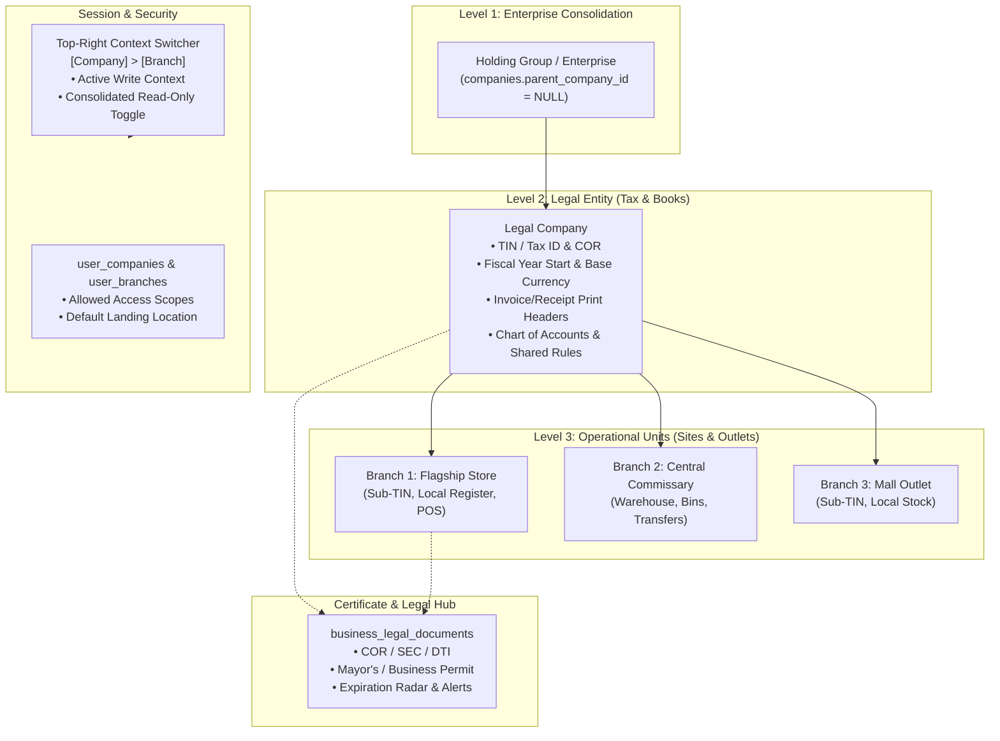

# Business Settings: Company & Branch Management Implementation Plan

> **For agentic workers:** REQUIRED SUB-SKILL: Use superpowers:subagent-driven-development (recommended) or superpowers:executing-plans to implement this plan task-by-task. Steps use checkbox (`- [ ]`) syntax for tracking.

This implementation plan delivers the complete **Business Settings: Company & Branch Management** subsystem for the Restaurant Management System (RMS). It establishes a 3-tier organizational hierarchy (Holding Enterprise > Legal Company > Operational Branch), a unified 4-tab Business Settings configuration console, a top-right context switcher with consolidated read-only mode, a Certificate & Legal Registration Hub with document expiration tracking, and session-driven document inheritance.

---

## 1. Architecture & Entity Relationship



---

## User Review Required

> [!IMPORTANT]
> **Database Schema Evolution:** Canonical tables `companies` and `branches` (mirroring `Software_Logics_Revised.xlsx`) will be deployed, with backward-compatible SQL views/aliases for `hr_companies` and `hr_branches` to guarantee that all existing HR module operations continue passing without breaking changes.

> [!NOTE]
> **Navigation Ergonomics:** In accordance with your selection, the User Profile dropdown is moved from the sidebar footer to the top-right header adjacent to the new Company/Branch Context Switcher. This frees up sidebar vertical space and keeps all identity/context controls unified in the primary header.

---

## Proposed Changes

### Component 1: Database Migrations & Seed Data

#### [NEW] `database/migrations/2026_10_12_000001_create_canonical_companies_and_branches_tables.php`
- Create `companies` table matching `Software_Logics_Revised.xlsx` (23 columns + blueprint enhancements for tax type, RDO, print disclosures, logo, favicon, hierarchy toggles).
- Create `branches` table matching `Software_Logics_Revised.xlsx` (20 columns + branch sub-TIN, site type, operating hours).
- Create `business_legal_documents` table for Document Vault attachments, issuing authority, license numbers, and expiration radar.
- Create `user_companies` and `user_branches` pivot tables.
- Add `default_company_id` and `default_branch_id` to `users` table.
- Seed/migrate existing `hr_companies` and `hr_branches` records into `companies` and `branches`.
- Establish backward-compatible SQLite/MySQL views for `hr_companies` and `hr_branches`.

---

### Component 2: Eloquent Models & Service Layer

#### [NEW] `app/Models/Company.php`
- Canonical model for Legal Entities & Enterprises.
- Relationships: `branches()`, `parentCompany()`, `childCompanies()`, `legalDocuments()`, `users()`.
- Accessors: `full_address`, `is_holding_group`, `active_branches_count`.
- Scopes: `active()`, `holdingGroups()`, `legalEntities()`.

#### [NEW] `app/Models/Branch.php`
- Canonical model for Operational Branches & Sites.
- Relationships: `company()`, `legalDocuments()`, `users()`, `warehouses()`.
- Accessors: `full_address`, `display_title`.
- Scopes: `active()`, `byCompany($companyId)`.

#### [NEW] `app/Models/BusinessLegalDocument.php`
- Polymorphic / direct document vault model.
- Attributes: `document_category`, `document_name`, `document_number`, `issuing_authority`, `issue_date`, `expiration_date`, `file_path`, `renewal_reminder_days`.
- Accessor `expiration_status`: returns `'Active'`, `'Expiring Soon'` (<=30 days), or `'Expired'`.

#### [MODIFY] `app/Models/User.php`
- Add `companies()` (BelongsToMany), `branches()` (BelongsToMany), `defaultCompany()`, `defaultBranch()`.
- Helper methods: `canAccessCompany($companyId)`, `canAccessBranch($branchId)`.

#### [MODIFY] `app/Models/Hr/Company.php` & `app/Models/Hr/Branch.php`
- Inherit or wrap canonical models to preserve all existing HR relationships (`employees()`, `departments()`).

#### [NEW] `app/Services/CompanyBranchContext.php`
- Singleton managing session context: `getActiveCompany()`, `getActiveBranch()`, `isConsolidatedView()`.
- Resolution fallback: Session -> User Defaults -> First Allowed -> System Fallback.
- Switch method: `switchContext($companyId, $branchId, $isConsolidated)`.

#### [NEW] `app/Http/Middleware/EnsureCompanyBranchContext.php`
- Runs on web routes to ensure valid context exists in session.
- Injects `$currentCompany`, `$currentBranch`, `$allowedCompanies`, `$isConsolidatedView` into all Blade views via View Composer.

---

### Component 3: Controllers & API Endpoints

#### [NEW] `app/Http/Controllers/BusinessSettingsController.php`
- `index()`: Loads active company, child branches, legal documents, and dictionary options.
- `updateGeneral(Request $request)`: Validates and updates Legal/Trade names, logo, favicon, localization, and corporate contacts.
- `updateLegalHub(Request $request)`: Validates and updates TIN, tax classification, RDO, invoice header/footer disclosures.
- `updateHierarchy(Request $request)`: Updates parent entity link and sharing toggles (Chart of Accounts, Catalog, Directory).
- `storeDocument(Request $request)`: Uploads PDF/image legal documents with expiry date into the Document Vault.
- `destroyDocument(int $id)`: Deletes vault file and record.
- `storeBranch(Request $request)`: Creates an operational branch under the current company.
- `updateBranch(Request $request, int $id)`: Updates branch details, sub-TIN, and operating hours.
- `toggleBranchStatus(int $id)`: Toggles active/inactive flag for a branch.

#### [NEW] `app/Http/Controllers/ContextSwitcherController.php`
- `switch(Request $request)`: Validates company/branch access and updates session active context.
- `setDefaultLanding(Request $request)`: Updates user's `default_company_id` and `default_branch_id`.

#### [MODIFY] `routes/web.php`
- Register `/business-settings` routes with update endpoints.
- Register `/context/switch` and `/context/default-landing` routes.

---

### Component 4: User Interface & Blade Components

#### [NEW] `resources/views/components/context-switcher.blade.php`
- Top-bar visual indicator: `[Company Logo & Name] > [Branch Badge & Name]`.
- Dropdown menu featuring:
  - Search input for real-time client-side filtering.
  - Grouped Accordion: Companies as root nodes, expanding to show child branches.
  - Active Write Mode click handler (submits context switch).
  - "Consolidated View (Read-Only)" toggle button.
  - Distinct badge/color styling for Head Office vs Branch vs Consolidated.

#### [NEW] `resources/views/components/header-user-profile.blade.php`
- Compact top-right profile avatar, full name, role pill.
- Dropdown menu: My Account Settings, Default Landing Location modal trigger, Theme Toggle, Sign Out.

#### [MODIFY] `resources/views/layouts/app.blade.php`
- Include `<x-context-switcher />` and `<x-header-user-profile />` in `header-actions`.
- Remove user-profile button from sidebar footer to avoid UI redundancy.

#### [MODIFY] `resources/views/components/sidebar.blade.php`
- Streamline bottom rail to focus purely on navigation items.

#### [REPLACE] `resources/views/config/business-settings.blade.php`
- Full industrial UI with 4 functional tabs:
  1. **General Business Profile:** Identity, Branding (Logo/Favicon dropzones), Localization, Physical/Billing addresses.
  2. **Certificate & Legal Registration Hub:** TIN, Tax status, Document Vault grid with expiration radar pills (🟢 Active, 🟡 Expiring Soon, 🔴 Expired), POS Receipt / Invoice disclosures preview.
  3. **Hierarchy & Relationship Setup:** Legal Company vs Branch type, Parent holding association, Shared vs Independent toggles.
  4. **Branches & Sites Hub:** Responsive data table of all operational branches, site type tags, status toggles, and Add/Edit Branch modal.

---

## Verification Plan

### Automated Tests
Run dedicated feature tests covering all blueprint capabilities:
```bash
php artisan test --filter BusinessSettingsModuleTest
```
Run regression tests to verify that HR Operations and RFQ/Inventory remain fully intact:
```bash
php artisan test --filter "HrOperationsTest|TalentAcquisitionModuleTest|EmployeeManagementModuleTest"
```

### Manual Verification
1. **Context Switcher:**
   - Click the top-bar switcher, search for "BGC" or "Makati", select a branch, and observe the header update immediately.
   - Toggle "Consolidated View" and verify read-only indicator badge appears.
2. **Business Settings Console:**
   - Visit `/business-settings`.
   - Update Trade Name and upload brand logo -> verify immediate preview and persistence.
   - Upload a test Certificate of Registration (PDF/image) with an expiration date -> verify Expiration Radar badge renders correctly.
   - Add a new operational branch (e.g., "Cebu Commissary") -> verify it appears in the table and in the top-bar switcher.
3. **User Profile Dropdown:**
   - Click top-right avatar -> verify shortcuts (Account Settings, Default Landing, Sign Out) function seamlessly.
